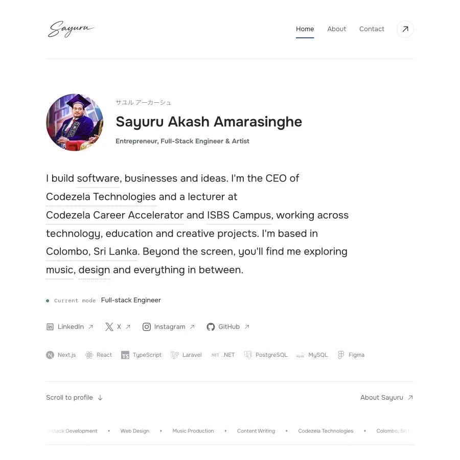
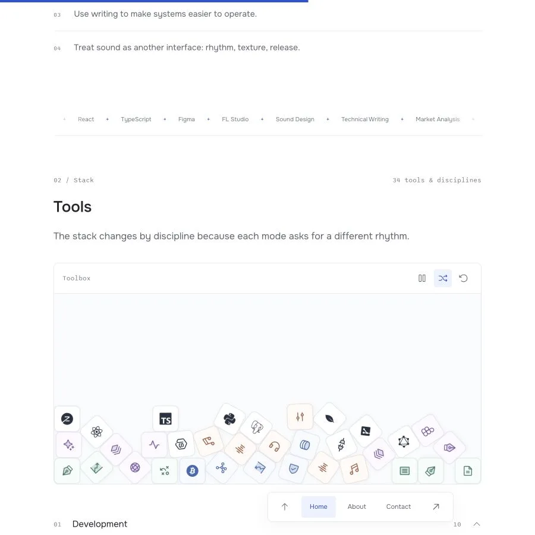

# Sayuru Akash Amarasinghe

**Entrepreneur, Full-Stack Engineer & Artist**

A personal home on the web for software, business, education, and creative work. Built around a light journal layout, considered typography, and small interactions.

[Website](https://sayuru.me) · [About](https://sayuru.me/about) · [Contact](https://sayuru.me/contact)



<details>
<summary>Mobile layout</summary>
<p></p>
</details>

## The Experience

- Four public pages: Home, About, Contact, and Privacy Policy.
- Context previews on important words in the introduction, with official organisation logos, links, and a Sri Lanka outline marking Colombo.
- A portrait with a cursor-following illustrated reveal.
- An interactive toolbox: draggable, falling skill icons with pause, shuffle, reset, and keyboard controls.
- Expandable skill groups and a personal photo archive with a keyboard-accessible viewer.
- Shared navigation, a floating navigation bar, email-copy actions, and a cursor-responsive dot footer.
- A contact form with server-side validation, Cloudflare Turnstile verification, and Resend delivery.
- Responsive layouts and reduced-motion fallbacks.

| Word previews | Interactive toolbox |
| --- | --- |
|  |  |

## Stack

| Area | Implementation |
| --- | --- |
| Application | Next.js 16 App Router, React 19, TypeScript |
| Design | Tailwind CSS v4, CSS variables, Onest and Sono |
| Motion | Motion, Lenis, CSS transitions |
| Interactions | Floating UI, Matter.js |
| Icons | Simple Icons, Phosphor Icons |
| Contact | Resend, Zod, Cloudflare Turnstile |
| Analytics | Google Analytics 4 through `@next/third-parties` |
| Verification | ESLint, Jest, Testing Library, production builds |

The technologies shown in the homepage tool row describe Sayuru's working stack. They are separate from the framework dependencies used to run this website.

## Run Locally

Requires **Node.js 20.9 or newer** and npm.

```bash
npm ci
cp .env.example .env.local
npm run dev
```

Open [localhost:3000](http://localhost:3000). Public content works without delivery credentials; sending a contact message requires the configuration below.

Use another port when needed:

```bash
npm run dev -- -p 3001
```

### Environment

Use [.env.example](.env.example) as the template. Keep real credentials in the ignored `.env.local` file or the hosting provider's environment settings.

| Variable | Purpose |
| --- | --- |
| `RESEND_API_KEY` | Server-side email delivery credential |
| `CONTACT_FROM_EMAIL` | Sender on a verified Resend domain |
| `CONTACT_TO_EMAIL` | Recipient for website inquiries |
| `NEXT_PUBLIC_TURNSTILE_SITE_KEY` | Public Turnstile widget key, included at build time |
| `TURNSTILE_SECRET_KEY` | Server-side Turnstile verification credential |
| `TURNSTILE_ALLOWED_HOSTNAMES` | Comma-separated hostname allowlist checked by the API |
| `NEXT_PUBLIC_GOOGLE_ANALYTICS_ID` | Public GA4 measurement ID; defaults to this site's ID |
| `NEXT_PUBLIC_GOOGLE_ANALYTICS_DISABLED` | Set to `true` before building to disable production analytics |

For local contact-form testing, use Cloudflare's official test keys and matching test hostname configuration, or configure a separate development widget. The production hostname restrictions should remain intact.

### Production Preview

```bash
npm run build
npm run start -- -p 3001
```

The contact API requires a **Node.js runtime**. Public pages are prerendered, but a static-only export cannot deliver contact submissions.

GA4 is disabled during `npm run dev` and enabled in production builds unless explicitly disabled. To preview a production build without collecting analytics:

```bash
NEXT_PUBLIC_GOOGLE_ANALYTICS_DISABLED=true npm run build
npm run start -- -p 3001
```

## Edit Content

| Change | Location |
| --- | --- |
| Introduction, roles, homepage tools, skills, biography, navigation, contact topics, privacy text | [data/portfolio.ts](data/portfolio.ts) |
| Word-preview copy, destinations, official source links | [data/hero-previews.ts](data/hero-previews.ts) |
| Sri Lanka outline and Colombo location | [data/sri-lanka-map.ts](data/sri-lanka-map.ts) |
| Content types | [types/portfolio.ts](types/portfolio.ts) |
| Fonts, colours, spacing, responsive layouts | [app/globals.css](app/globals.css), [app/layout.tsx](app/layout.tsx) |
| Brand icon mappings | [app/components/BrandIcon.tsx](app/components/BrandIcon.tsx) |
| Portraits and personal archive | [public/images](public/images) |
| Favicon variants and web app manifest | [public](public) |

Keep the approved introduction intact when changing its interactive annotations. Changing a tool name may also require a matching brand icon.

## Structure

```text
app/
  layout.tsx                 Shared shell, fonts, metadata, schema, analytics
  page.tsx                   Homepage section composition
  about/                     Biography, timeline, personal archive
  contact/                   Contact form and social channels
  privacy-policy/            Privacy information
  api/contact/route.ts       Validated Turnstile and Resend submission flow
  components/                Shared UI, motion, previews, physics, tests
  hooks/                     Component-level hooks
  sitemap.ts                 Public-page sitemap
  robots.ts                  Crawler rules
  opengraph-image.tsx         Social sharing image
data/                        Editable content and map geometry
hooks/                       Shared motion hooks
lib/                         Contact validation and email rendering
types/                       Shared TypeScript contracts
utils/                       Reusable animation configuration
public/                      Local images, icons, manifest
docs/                        Maintenance notes and screenshots
```

## Verify Changes

```bash
npm run lint
npm run test -- --runInBand
npm run build
```

For visible changes, also inspect desktop and mobile layouts, keyboard navigation, reduced motion, image loading, and browser console output. Automated checks do not prove that an email reached its destination or that a deployed CDN serves the latest build.

## SEO, Assets, and Analytics

- Canonical URLs, social metadata, Person/WebSite schema, and per-page schema are defined in the App Router files.
- The sitemap, robots endpoint, and generated Open Graph image are part of the application.
- Images are pre-optimized local assets. Next Image supplies layout and loading behavior; provider-side image optimization is intentionally disabled.
- Files under `/images/` receive long-lived immutable caching. Give replacement images new filenames.
- The generated red S mark has dedicated 32, 180, 192, and 512 pixel PNG variants.
- GA4 loads after hydration. Page views rely on Enhanced Measurement; keep browser-history page changes enabled in the GA4 property and avoid adding duplicate manual page views.
- Custom events report Web Vitals and successful contact submissions. Contact names, email addresses, messages, and submission references are excluded from those custom event payloads.

Organisation previews use official [Codezela Technologies](https://codezela.com/), [Codezela Career Accelerator](https://cca.it.com/about-us/), and [ISBS Campus](https://isbs.lk/about/) information. The outline uses public-domain [Natural Earth](https://www.naturalearthdata.com/about/terms-of-use/) geometry, with Colombo coordinates from the Sri Lanka Survey Department through [UNGEGN](https://ungegn.un.org/dashboard/cities/details?id=127).

See [maintenance notes](docs/MAINTENANCE.md) for release checks, content updates, and troubleshooting. Repository coding guidance lives in [AGENTS.md](AGENTS.md).
